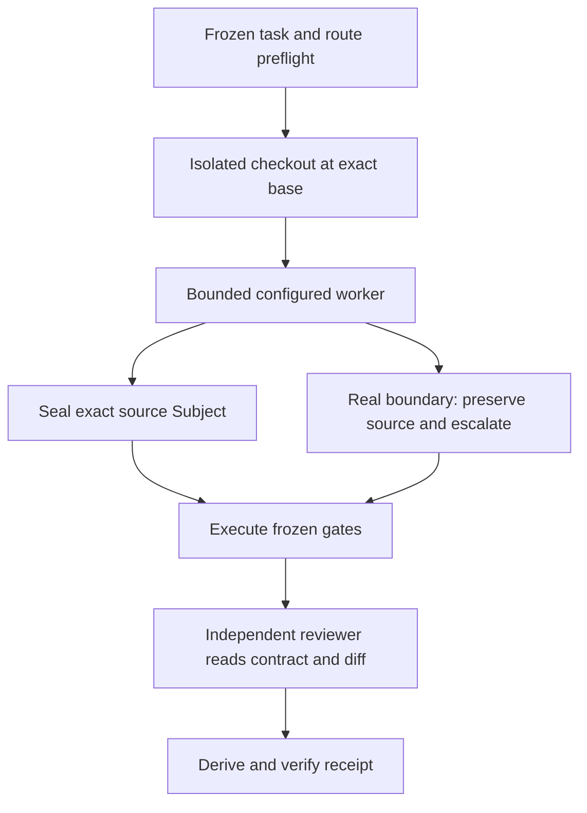
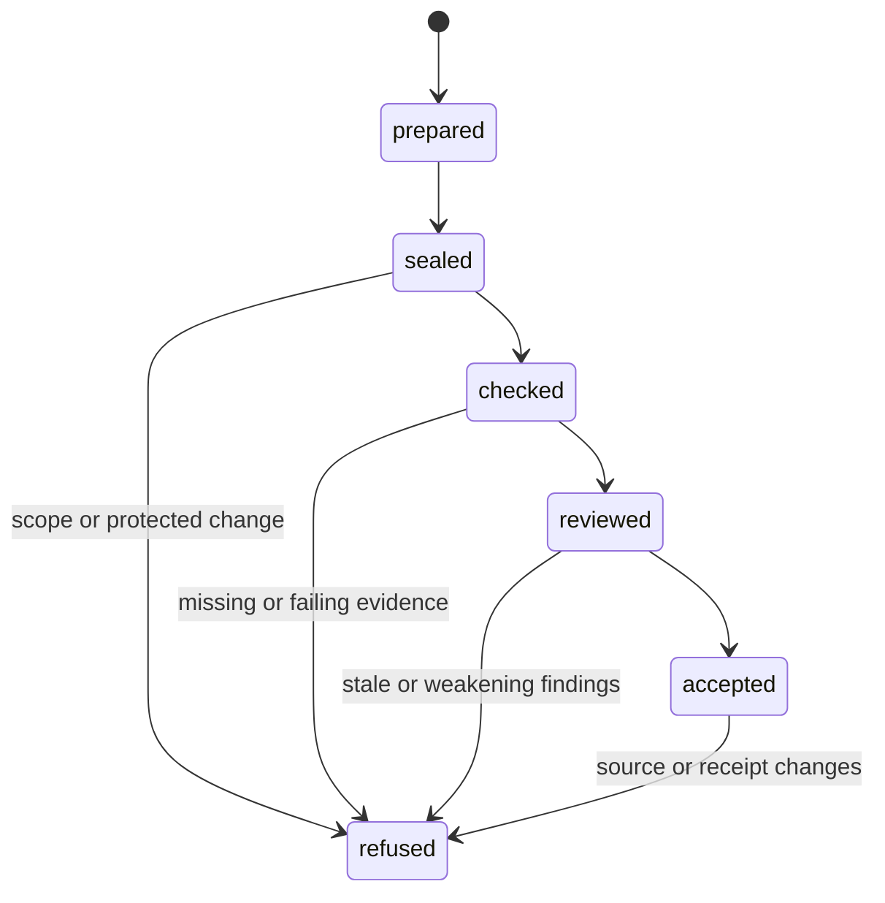

# Auditable Acceptance Workflow - Plan

## Goal Capsule

- Objective: an operator can distinguish accepted repository work from stale, incomplete, unreviewed or acceptance-weakening work using reproducible receipts.
- Means: a repository-local Python CLI and existing configured OMP task routes, with isolated Git checkouts and independently recorded review.
- Authority: the unchanged 0008a contract, root contributor contract and `docs/design/quality.md` govern this plan.
- Execution profile: one independently mergeable increment; leave all changes uncommitted as requested.
- Stop conditions: missing configured route/authorization at startup, an unauthorized external effect, storing sensitive transcripts in Git, or weakening acceptance.
- Sol integrates and verifies; workers own bounded files; reviewers remain read-only.

---

## Product Contract

### Summary

Implement the complete standalone Done-when in `docs/goals/archive/0008a-auditable-acceptance-workflow.md` without changing that contract.
Produce live Go work, a real escalation, observed rejection controls, operational instructions and scoped skills.

### Problem Frame

Successful generation and a green command do not establish that the reviewed artifact, frozen acceptance contract and final working revision are identical.
The repository already has exact-source binders, strict Go event checks and isolated evidence scripts, but no task-level model-routing evaluation directory or end-to-end task receipt workflow.

### Requirements

**Frozen execution and acceptance**

- R1. Freeze the task, base commit, allowed changes, protected assets and required executable gates before implementation in an isolated checkout.
- R2. Bind checks and independent review to the same exact evaluation Subject, including uncommitted, untracked and ignored source bytes.
- R3. Refuse stale Subjects, absent/failed/skipped gates, modified protected tests/guards and incomplete or fabricated receipt claims.
- R4. Preserve correct work when a real quality-policy escalation boundary is reached, carrying the exact failing evidence to the stronger configured route or Sol.

**Audit and delivery**

- R5. Record the fixed quality-policy task fields, actual served models, routing provenance, credential-route metadata and prompt hashes without storing sensitive transcripts in Git.
- R6. Account for exploration, implementation, verification, review, repair and failed attempts; retain unknown usage or prices as null with reasons and price-version provenance.
- R7. Produce a lightweight-worker successful live Go sample, a negative real-boundary sample and an independent review on the produced revision.
- R8. Deliver runnable repository instructions, scoped skills, executable regression checks, sanitized evidence and unchanged contract archival only after completion.

### Scope Boundaries

- No model/profile/credential/cap selection, policy promotion, performance comparison, provider-side resource mutation or new service.
- No migration or wire-protocol change; an evaluation Subject is not a Control `resource_id` or an `achieve` authorization.
- No claim that a same-user local checkout is a security sandbox; the trusted coordinator owns receipts outside the worker checkout.
- No repair of the separately recorded Linux containment issue merely to obtain a sample.

---

## Planning Contract

### Key Technical Decisions

- KTD1. Use the existing `scripts/ci` Python CLI/unittest convention, following executable evidence increment `8ded77150ec0ae49d52355670fdad78a348bf1d5` (OmO witness and rejection tests), rather than introducing a framework.
- KTD2. Reuse `linux-v2-source-subject.py` for clean-base qualification and `assert-go-test-json.py` for required named-test execution; do not relax either helper.
- KTD3. Represent an uncommitted head honestly: retain the actual base/head commit IDs and bind the complete source manifest in a separately namespaced evaluation Subject hash. No synthetic commit, index mutation in the user's checkout, or fabricated head SHA.
- KTD4. Keep a frozen coordinator-owned run directory outside the isolated checkout. The runner seals source state, executes frozen argv gates, records exit codes/output digests, imports independent review and derives the receipt. Acceptance compares a submitted receipt against derived evidence, not its self-reported `accepted` flag.
- KTD5. Protect existing tests, schema/gate/skill/instruction assets and declared guards by default. Allow bounded new regression files; changes to protected assets require a different owner-approved frozen task, not worker reinterpretation.
- KTD6. Use existing configured native routes without overrides. Startup requests have succeeded on `scout` / `reviewer`; resolve actual model and usage from harness records, not the agent's self-description.
- KTD7. Extract only allowlisted metadata and hashes from private OMP JSONL. Harness cost numbers are estimates without a supplied price version; record their sum as a known estimate with that limitation, never provider billing or zero cost.
- KTD8. Separate behavioral acceptance from accounting completeness. A structurally complete receipt may truthfully contain unknown billing; it cannot claim measured savings or complete billing evidence.

### High-Level Technical Design

### Assumptions

- The live Go positive sample adds regression coverage for failed Subject decoding preserving an existing receiver, using the actual production decoder rather than a mock. Search found no such receiver-preservation assertion in `daemon/internal/protocol`.
- The escalation sample will attempt to qualify the existing Linux final-scan invariant on this Windows host. A required named Linux test that cannot run is failing evidence, not permission to skip it or weaken containment; preserve the positive sample and hand off to Sol.
- The runner is harness-neutral; this increment's live usage extractor supports the actually available OMP JSONL format. Other harnesses must provide equivalent observed metadata before a receipt is complete.
- Bind every checkout file except `.git` internals. Gitignore is not a compiler boundary: the repository's `*.local.*` pattern can hide a `.local.go` file that Go still compiles. Keep gate outputs outside the checkout or clean them before sealing; no output-exclusion mechanism is introduced.

---

## Implementation Units

### U1. Frozen execution and receipt verification

**Goal:** make stale, missing and weakening evidence unacceptably explicit.

**Requirements:** R1–R3, R5–R6; KTD1–KTD5, KTD8.

**Dependencies:** none.

**Files:** `scripts/ci/model-routing-evaluation.py`, `scripts/ci/test-model-routing-evaluation.py`.

**Approach:** implement prepare/seal/check/review/receipt/accept CLI operations with strict JSON parsing, isolated checkout, source binding, frozen gate execution, independent review validation and derived receipts.

**Patterns to follow:** existing clean-source binder, Go test event assertion CLI and witness rejection tests.

**Test scenarios:**

- A real disposable Git checkout executes a frozen passing command and independent review, then accepts exactly its derived receipt.
- Edited source after checks or review, including ignored `.local.go` source, is refused without deleting work.
- A missing gate, failed command or skipped/absent named Go test is refused.
- Modifying an existing test, frozen task or declared guard is refused even when commands pass.
- Missing receipt fields, changed costs, fabricated check status, duplicate keys and nonfinite numbers are refused.
- Unknown usage/billing remains null and distinct from known zero.

**Verification:** CLI-level regression tests exercise observable refusals and preserve rejected work.

### U2. Usage extraction and operational assets

**Goal:** make the workflow reusable with actual routing and total-cost provenance.

**Requirements:** R4–R6, R8; KTD6–KTD8.

**Dependencies:** public CLI/data contract from U1; authoring can proceed alongside U1 once fixed.

**Files:** `scripts/ci/model-routing-omp-usage.py`, `scripts/ci/test-model-routing-omp-usage.py`, `docs/evaluations/model-routing/README.md`, task/review instructions and `.agents/skills/symmetry-acceptance-workflow/SKILL.md`.

**Approach:** extract actual model/role/usage, prompt hashes and opaque session refs without exporting transcript contents; document trusted-coordinator responsibilities and all phases including unsuccessful attempts.

**Test scenarios:**

- Known usage is summed across all assistant records, including failed attempts.
- Missing usage, cost or price version is marked incomplete rather than zero.
- Exported rows contain no prompt, tool payload or credential values.
- Fresh-context execution follows the positive task and hands off at the real missing-invariant evidence boundary.

**Verification:** parser regressions plus actual worker/reviewer records and sanitized output inspection.

### U3. Live evidence and closure

**Goal:** demonstrate every standalone Done-when clause with real observed results.

**Requirements:** R1–R8.

**Dependencies:** U1 and U2.

**Files:** bounded Go regression file, evaluation task contracts/receipts under `docs/evaluations/model-routing/`, `docs/evidence/goal-0008a-auditable-acceptance-workflow-2026-11-15.md`, `.github/workflows/ci.yml`, quality-policy links and goal archive/index.

**Approach:** run one positive lightweight Go task, qualify its exact source, execute the negative invariant boundary and preserve correct work, obtain independent review, run rejection controls, then reconcile docs.

**Test scenarios:** all R3 refusal classes, actual live Go command with named test run/pass counts, real escalation with preserved work, and independent review of the exact accepted Subject.

**Verification:** real exit codes, per-test counts, Subject hashes, route provenance and phase ledger; no synthetic substitute for live Go work.

---

## Verification Contract

| Surface | Required evidence |
| --- | --- |
| Python workflow | `python scripts/ci/test-model-routing-evaluation.py` and usage-parser tests, with counts and exits |
| Existing reuse | existing source-subject regressions and Go event-gate behavior remain unchanged |
| Live Go | focused `go test -json -count=1` plus `assert-go-test-json.py`; `go vet ./...` and `go test ./...` in daemon |
| Negative boundary | actual named Linux-invariant test qualification attempt and refusal, not skipped success |
| Independent review | separate configured reviewer reads the frozen requirement, produced diff, checks and Subject |
| Skills | fresh-context main path and adjacent refusal path; state discovery limits separately |
| Accounting | all worker, review, exploration, repair and failed attempts, including this coordinating session, with known estimates and unknown price provenance |

Never execute evaluation/measurement work concurrently with the full Go suite.
Linux/race, Control, wire and native gates remain required where applicable; this increment changes none of those runtime behaviors and does not claim their execution on an unavailable host.

---

## Definition of Done

Every clause in the unchanged goal has an evidence reference and observed outcome.
Independent review has no unresolved acceptance defect on the produced source Subject.
Scoped simplification preserves the frozen contract; remove abandoned implementation and temporary scripts.
Archive the contract byte-unchanged and update its index only when these predicates hold.
Report exact commands, counts, exit codes, unrun checks and residual limits; leave the tree uncommitted.
