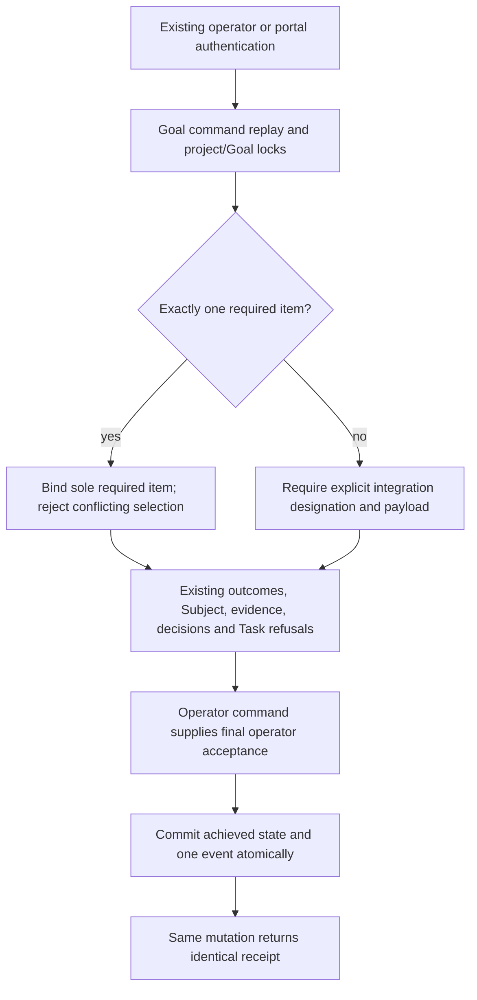
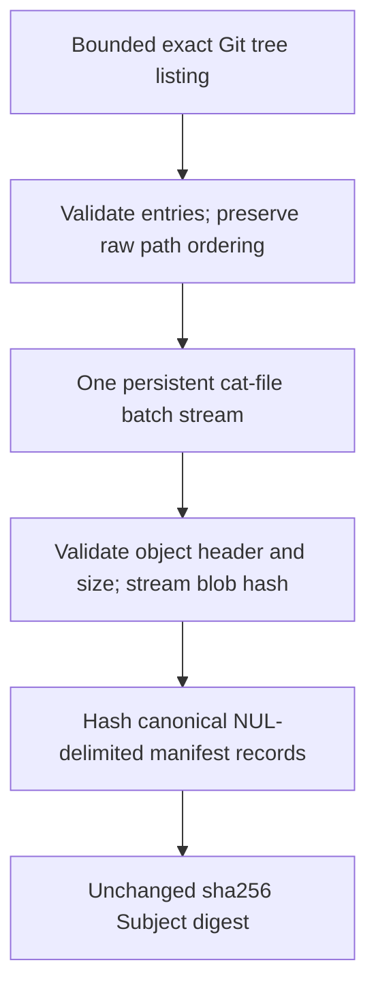

# Achieve Contract Amendments - Plan

## Goal Capsule

- Objective: operators can achieve an eligible Goal without approving their own completion decision, and a single required item needs no repeated integration selection.
- Means: amend existing Control transitions and projections, retain additive protocol v1, and replace per-blob Subject reads with one batch stream (KTD1–KTD3).
- Authority: the unchanged Goal 0009 contract governs this plan; PostgreSQL remains the durable authority.
- Execution profile: one independently reviewable increment, left uncommitted on the current branch at capture; later frozen for review as commit `8168badf818b4ef3e4cba2f86eaac1ec0e04ce18` with the test-only successor `bcd7216633466b9797bc446601f83b6d83501116`; no push or history rewrite.
- Completion owner: the parent implements/integrates and runs verification; an independent read-only reviewer reviews the amendment; the owner supplies only the subsequent owner verdict.
- Stop conditions: missing approved local repository/resource identity, a necessary widening of A/B, a changed digest wire format, or rewriting completed 0006 history.

---

## Product Contract

### Summary

Implement the three approved amendments in the existing domain owners and record new evidence for every standalone Done-when outcome.
The contract itself, not this plan, remains the completion authority.

### Problem Frame

The current operator command requires a separately resolved completion decision, plan admission requires an explicit integration marker even with one required item, and Subject observation starts a Git process for each blob.
The recorded 0006j witness exceeded its existing 30-second observation deadline on 1,033 blobs.

### Requirements

**Acceptance and integration**

- R1. An authenticated operator achieve is final operator acceptance, including a Goal-level operator-acceptance predicate; WorkItem acceptance and other authorities' decisions keep their existing requirements.
- R2. Before achieve, an otherwise eligible operator Goal offers achieve without a phantom completion decision in completion, allowed actions, blockers, or attention.
- R3. Exactly one required item automatically supplies the integration role at plan admission and achieve, ignoring optional items when counting.
- R4. In that case, any explicit integration marker on a different item or integration payload selecting a different item is refused; all other required-item counts retain explicit designation and payload requirements.
- R5. Proposal identity/hash, immutable admitted plans, command mutation identity, replay, fences, evidence predicates, unresolved-decision refusal, nonterminal-task refusal, and transaction boundaries remain binding.

**Subject observation**

- R6. Canonical Subject keeps the exact sha256 wire format and canonical raw-path manifest, using one persistent cat-file batch stream regardless of blob count.
- R7. On the same clean commit with more than 1,000 blobs, production Subject observation equals the existing independent script byte-for-byte and finishes inside the existing 30-second witness deadline.
- R8. Existing blob/tree bounds, unsupported entries, missing objects, replace-object protection, context cancellation, and child cleanup remain fail-closed.

**Evidence and closure**

- R9. Run a real local Goal through readiness, achieve, its event, and identical replay, plus the required refusal and single-/multi-required-item scenarios; do not substitute fixture-only success for that run.
- R10. Record actual commands, exit codes, counts, measurements, independent review, and limitations; archive the Goal unchanged only after its Done-when evidence exists.

### Scope Boundaries

- No provider publication, merge, remote repository mutation, new model route, or unrequested spend.
- No native harness capability promotion, timeout increase, digest format change, or rewrite of 0006 receipts/archives.
- No new scheduler, authority role inferred from an actor string, compatibility shim, or accepted-plan rewrite.
- Existing global format/warning debt is not silently suppressed or fixed as unrelated work.

---

## Planning Contract

### Key Technical Decisions

- KTD1. Keep the existing authenticated operator command boundary. `GoalController` is the only production caller of `Goals.command`; API and portal routes authenticate operators before constructing the actor audit label. Satisfy only the command's final operator acceptance directly, not WorkItem review acceptance. On the operator final-acceptance path, preserve validation of a non-null supplied completion decision, including scope/Subject/action identity; `decision_id` stays required and nullable on wire. On that path a previously resolved reject for the exact current Goal/revision/Subject remains ineligible with `invalid_decision`, including when the new payload supplies null; projections must not advertise that rejected Subject. Preserve the existing deterministic final-authority branch unchanged. This implements R1/R2/R5 without creating a prefix-based role system.
- KTD2. Compute the single-required-item binding after validating the approved proposal and its hash. Persist its derived integration designation while leaving the canonical approved proposal unchanged. Initial plan admission already refuses any existing current-revision items, so it cannot silently rewrite an admitted plan. Refuse a different explicit integration item before insertion. At achieve and in projections, apply the same required-count rule, including older admitted single-required-item plans without mutating their rows. A conflicting persisted designation is also refused, never ignored as stale or silently overridden; such a Subject is not ready. Other counts retain explicit rules. No migration or relaxation of the existing deferred integration guard is planned (R3–R5).
- KTD3. Separate tree-entry parsing from bounded blob hashing and reuse one cat-file batch process for the complete digest, including the Linux clone consumer. Retain each command factory's replace-object, environment, process-group, cancellation, and cleanup policy. The Linux clone batch is one Git command and therefore receives the existing five-minute per-command budget once, not once per blob; the separate measurement context is thirty seconds. Stream bounded object contents into SHA-256 instead of retaining a new whole-manifest or whole-blob copy when avoidable. The standalone artifact reader may retain its independent one-object operation (R6–R8).
- KTD4. The schema cannot know persisted required-item cardinality. Make `integration_work_item_id` structurally optional, document its exact conditional obligation on that property/payload, and enforce cardinality/conflicts in Control. Do not invent a caller-controlled required-count field. Regenerate all existing DTO/schema outputs through the repository generator (R3–R5).
- KTD5. Use new regression evidence, not old ceremony receipts. Preserve existing tests except expectations directly changed by A/B, with rationale and independent review. The parent records red-before-production and green-after integration; workers do not run concurrent gates (R9/R10).

### High-Level Technical Design

### Assumptions and Reversible Defaults

- Native execution uses the configured task agents without explicit model overrides; the parent owns verification.
- Approved local resource `eb968617-36be-48ce-8321-b6b20f7ce77f` exists in project `139a5747-5878-4503-9972-1bd3a46b9400` in the running local acceptance DB. The existing online `accept-omo` runtime binds that resource and workspace `subject` to `/workspaces-accept`; health returned HTTP 200. This is not a production identity.
- Use fresh goal/mutation identities for this run, preserve old achieved Goals, and restrict local acceptance effects to new run-owned work. Inspect actual runtime configuration without recording credential values.
- Run new Control and daemon builds from this working tree, recording their source/build identities. The disposable acceptance DB is a consistent local snapshot preserving the approved resource identity; its five existing Tasks and four Goals were all terminal before any manual dispatch. Its automatic scheduler, reaper and integration sync remain disabled; dispatch new owned Tasks through the existing scheduler API. No existing service or original DB is modified. Use the existing configured OmO provider/model unchanged, with run-owned state, sessions and repository copy.
- Measurement target: the clean WSL checkout `/tmp/symmetry-0009-subject`, copied from the approved `/workspaces-accept`, at `8ded77150ec0ae49d52355670fdad78a348bf1d5`; initial HEAD and clean status were observed, with 1,091 tree entries. The measurement must assert all counted entries are blobs and no replace refs affect the independent oracle.
- Reuse existing local tools/containers where safe; isolate build/test state and runtime ports from concurrent work. Do not install a new host runtime merely to replace an available container runtime.
- A no-commit deliverable records the base commit and exact tested working-source identity separately from the acceptance repository Subject. No old evidence certifies the changed implementation.
- No external research is needed: the local approved contract, current implementation, existing independent digest script, and preserved transaction rules determine the change.

### Evidence Shape and Sources

The feature shape is merge `8ded771` (PR #22): production source, consumer-visible regressions, runnable acceptance witness, bounded sanitized receipts, exact verification results, and independent review.
The closure shape is `docs/evidence/goal-0006i-exact-subject-release-acceptance-2026-11-15.md` and the Goal index's unchanged archival convention.
The prior Subject witness is `scripts/ci/linux-v2-source-subject.py`; the 30-second origin is the 0006j receipt's native-acceptance section, not a new daemon timeout.
Relevant owners are `Goals.ensure_achievable!`, plan preflight/admission, `Goals.ReadModel` completion/blocker/attention derivation, and workspace `subject.go` plus the Linux clone digest caller.

---

## Implementation Units

### U1. Operator acceptance and automatic integration

**Goal:** enforce R1–R5 in the current Control transition and projection owners.

**Dependencies:** none.

**Files:** `control/lib/symmetry_control/goals.ex`, `control/lib/symmetry_control/goals/read_model.ex`, `control/test/symmetry_control/goals_test.exs`, `control/test/symmetry_control/goals_read_model_test.exs`, and focused controller/contract tests only where the changed boundary requires them.

**Approach:** retain the existing command transaction/replay path; bind integration only after proposal/hash validation; update completion and attention from the same admitted-state rule. Preserve all unrelated decision/evidence/dependency guards.

**Execution note:** add or amend the smallest consumer-visible regressions first; the parent observes their failure before production changes.

**Patterns to follow:** existing terminal producer → independent validation → settlement → achieve test; current `plan_admission_preflight?`; existing projection/attention tests.

**Test scenarios:**

- Ready operator Goal with accepted matching integration outcome and required evidence achieves directly, emits one event, and replays identically without a completion decision.
- Goal-level operator acceptance is satisfied by that command; WorkItem review acceptance still requires its own correctly scoped decision.
- Before achieve, readiness, allowed actions, blockers, and attention expose no phantom decision.
- One required item, with optional items before/after it and no integration markers, admits with the same authorized proposal hash and achieves without the integration payload field.
- A different optional item marked integration or selected explicitly is refused; multi-required-item plans and achieve retain both explicit obligations.
- A legacy conflicting stored designation remains refused without rewriting its admitted rows; a resolved completion reject for the exact current Subject remains refused and not ready.
- Missing outcomes, mismatched integration Subject, unresolved decisions, nonterminal optional tasks, and a foreign/wrong-authority decision still refuse.
- Stale revision/version and conflicting mutation bodies retain existing refusal/replay behavior.

**Verification:** focused Control tests prove these outcomes and existing migration/constraint tests remain unchanged; the real local witness is U4.

### U2. Single-stream Subject observation

**Goal:** enforce R6–R8 on both production digest consumers.

**Dependencies:** none.

**Files:** `daemon/internal/workspace/subject.go`, `daemon/internal/workspace/subject_test.go`, `daemon/internal/workspace/linux_clone_linux.go`, and affected Linux clone tests if needed.

**Approach:** KTD3; preserve the independent script as the unmodified equality oracle.

**Patterns to follow:** existing bounded Git output lifecycle, existing `linuxCloneGitCommand` process policy, canonical Subject tests, independent single-stream script.

**Test scenarios:**

- Multiple blobs produce the canonical digest using exactly one batch stream, not per-blob cat-file processes.
- Raw path order, executable files, symlinks, embedded binary bytes, and replace refs preserve existing digest semantics.
- A missing blob, oversized blob/tree, and unsupported tree entry fail closed; a cancelled context leaves no owned child stream running.
- The Linux clone path retains its restricted command/process policy and yields the same digest.

**Execution note:** first expose the old per-blob behavior through an external process trace or equivalent production-path observation; the parent records the expected failure.

**Verification:** focused workspace tests, then an opt-in in-module test invoking production `Manager.MaterializeSubject` on the named clean checkout with a thirty-second context, matching the recorded witness mechanism. Run the unchanged independent script on the same commit, assert >1,000 blobs and no replace refs, and record digest equality, measured wall time and process-stream evidence. No new production measurement export or CLI is needed; never run measurement concurrently with full suites.

### U3. Additive wire and fixed-design amendment

**Goal:** express R1–R8 without changing unrelated acceptance.

**Dependencies:** interface semantics in KTD1/KTD2/KTD4 are fixed; implementation can proceed independently in disjoint files.

**Files:** `docs/design/contracts.md`, `docs/design/data.md`, `docs/design/protocol.md`, `docs/design/core.md`, `contracts/v1/goal-command.schema.json`, relevant `common.schema.json` descriptions, `contracts/README.md`, shared fixtures/manifest, and generator-owned outputs.

**Approach:** explicitly label the owner-approved amendment and rationale; reconcile old unconditional completion-decision/integration language, retain the nullable decision shape, and state B's conditional requirement. Preserve the hash default for omitted integration markers.

**Patterns to follow:** existing canonical Draft 7 schema, fixture manifest, and generated-file gate.

**Test scenarios:**

- Omitted integration payload is structurally valid but remains subject to server cardinality enforcement.
- Null/malformed integration UUID and malformed/omitted decision_id remain structurally refused as before.
- Existing valid explicit commands and proposal-default/hash fixtures continue decoding identically in all boundaries.

**Verification:** generate through the existing generator; contract check plus Go and Control fixture consumers pass with recorded counts.

### U4. Real acceptance, measurement, review, and closure

**Goal:** produce R9/R10 evidence for the integrated implementation.

**Dependencies:** U1–U3.

**Files:** run-owned local witness/receipts under `.tmp/`, retained reproducible witness under `scripts/ci/` where needed, a new `docs/evidence/goal-0009-achieve-contract-amendments-2026-11-15.md`, `docs/goals/README.md`, and unchanged move of the Goal to `docs/goals/archive/`.

**Approach:** drive the actual local authenticated operator-bearer HTTP API and daemon validation surface with new Goal identities and new evidence; record each refusal, plan hash/replay, pre-achieve projection, achieved event, and replay identity. Domain-only setup/readback cannot substitute for authenticated achieve evidence. Separate the measured repository commit from the tested dirty implementation identity. Run scoped simplification and independent read-only amendment review before closure.

**Test scenarios:** the standalone Goal contract's complete Done-when list; fixture-only tests are supporting evidence, not substitutes for the real local run.

**Verification:** each Done-when bullet links to actual sanitized receipts, exact commands, counts/exit codes, and measurements. The owner's verdict remains awaiting review, never model-signed.

---

## Verification Contract

| Surface | Required evidence |
| --- | --- |
| Regression baseline | Parent-run focused tests fail for the intended old A/B/C behavior before production edits. |
| Control | Changed-file formatting, canonical `mix format --check-formatted`, `mix compile --warnings-as-errors`, focused tests, then `mix test`; record inherited failures instead of suppressing them. |
| Go | Changed-file gofmt, Windows `go vet ./...` and `go test ./...`; available WSL Linux `go build ./...`, `go vet ./...`, workspace checks and `go test -race ./...`; record native fixture skips and unavailable qualification rather than treating compilation as runtime proof. |
| Contracts | Existing `pnpm contracts:generate`, then `pnpm contracts:check`, plus language fixture consumers. |
| Real surface | Local authenticated API/readiness/achieve/replay and all mandated refusal classes, using new durable run-owned rows. |
| Subject | Production >1,000-blob observation within 30 seconds, independent script equality on the same clean commit, elapsed wall time and process-stream evidence. |
| Review | Scoped simplification and independent authority/recovery/amendment review, with findings and repairs recorded. |

Do not run measurement concurrently with any full test suite on this host.
No CI, hosted runner, native capability, billing, or check not actually executed is reported passed.

---

## Definition of Done

Every standalone Done-when bullet in Goal 0009 has its own new evidence reference.
The final receipt distinguishes source verification, real acceptance Subject, supporting tests, skips, and limitations.
The requested uncommitted deliverable is not a published PR; any later source change invalidates affected proof until reverified against that exact source identity.
All reachable required gates have run with their actual exit codes recorded; missing proof remains missing, never inferred from old runs.
Abandoned source overlays and throwaway programs are removed; unrelated user/generated work and all completed 0006 history remain untouched.
The Goal moves unchanged only when its required implementation/evidence is produced, and the index points to the new receipt and archived contract.
Owner review is recorded as produced and awaiting the owner's verdict.
