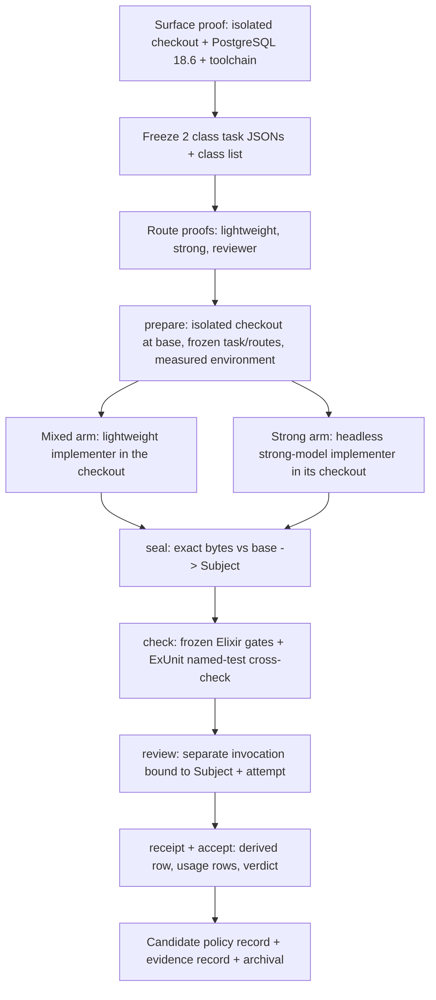

# Evidence-based Elixir Model Routing - Plan

## Goal Capsule

- Objective: a candidate, evidence-backed Elixir routing policy: per tested class, promote-lightweight / strong-only / insufficient evidence, produced from a mixed-model run and a strong-only baseline under identical contracts.
- Means: the accepted 0008a workflow (`scripts/ci/model-routing-evaluation.py`, source subject seal, receipt/manifest format) reused and extended in place for Elixir, two frozen Elixir task classes, four evaluated runs on real PostgreSQL.
- Authority: the unchanged `docs/goals/archive/0008c-elixir-model-routing.md` contract (archived byte-identically), root `AGENTS.md`, `docs/design/quality.md` and `docs/design/README.md` govern this plan.
- Execution profile: one independently mergeable increment; owner acceptance of the routing policy is explicitly out of scope and stays pending.
- Stop conditions: missing accepted 0008a workflow, missing configured routes/authorization, or a missing Elixir/PostgreSQL execution surface (fail before any partial run); publishing the policy as accepted; removing a risk class from the frozen set; exceeding existing authorization; accepting a class whose gates did not run.
- Sol integrates and verifies; workers own bounded files; reviewers remain read-only.

---

## Product Contract

### Summary

Implement the standalone Done-when of `docs/goals/archive/0008c-elixir-model-routing.md`:
prove the Elixir/PostgreSQL surface, freeze two Elixir task classes, run both arms per
class with identical contracts/permissions/budgets/evidence/checks/review, bind each accepted
result to executed gates and an independent semantic review, and publish a candidate policy
record with per-class verdicts, negatives, evidence gaps and a scope statement.

### Problem Frame

The 0008a workflow is accepted and exists, but has only ever evaluated Go tasks with a Go
named-test execution gate. `docs/design/quality.md` requires the same evidence standard for
Elixir (`mix format --check-formatted`, `mix compile --warnings-as-errors`, `mix test`, plus
the CI integration steps), and the repository has no recorded Elixir routing evidence.
Elixir work has three properties the Go carrier did not exercise: the gates require a real
PostgreSQL, the full suite is the dominant verification cost, and a `mix test` file can exit 0
while executing one test or none.

### Requirements

**Surface proof (before any run)**

- R1. Prove in an isolated checkout at the frozen base that the formatter, warning-as-error compilation, the full `mix test` suite and the applicable CI integration gates execute on this host against a real PostgreSQL, with recorded exit codes.
- R2. If that surface is unavailable, stop and report the exact missing item before starting any run.

**Frozen classes and identical arms**

- R3. Freeze two Elixir classes (established-pattern edit; database constraint/concurrent writers/transaction/rollback/authority) with their task JSON, allowed paths, protected paths, gates and required explanations, before either arm runs.
- R4. Run each class twice — mixed workflow and strong-only baseline — with the same frozen task bytes, the same permissions, budgets, gates, evidence shape and the same configured reviewer route; only the implementer route differs.
- R5. Every accepted result passes the frozen Elixir gates and an independent semantic review bound to that run's sealed Subject.

**Accounting and evidence**

- R6. Record actual served model identities, provenance, prompt identity hashes, the credential route used as metadata (never secrets), and token/cost rows per accepted change, covering exploration, implementation, verification, review, repair and failed attempts; unknown billing stays unknown with a price version.
- R7. State the proven execution surface per class in the receipt row's `environment` field, including the toolchain route, PostgreSQL identity and the host the gates ran on.

**Policy and scope**

- R8. Produce a candidate policy record with per-class promote-lightweight / strong-only / insufficient-evidence verdicts and the evidence behind each, carrying every acceptance regression, not-cheaper class and evidence gap explicitly.
- R9. Make no claim for untested Elixir work, Go or TypeScript; invent no savings percentage or cost figure; hardcode no model name into domain policy.

### Scope Boundaries

- No new model profile, credential, spend cap or per-call model override beyond the two existing configured routes the goal itself contrasts.
- No promotion of the policy (owner verdict), no Control `achieve`, no wire/protocol change, no gate weakening, no Go/TypeScript/browser claim.
- No new service, no second measurement pipeline: the 0008a runner, subject seal, receipt and manifest are extended in place.
- No fabricated, estimated or synthesised numbers: a run that cannot execute is reported as such and never softened into partial results.

---

## Planning Contract

### Key Technical Decisions

- KTD1. Reuse `scripts/ci/model-routing-evaluation.py`, `model-routing-omp-usage.py`, `linux-v2-source-subject.py` and the frozen receipt/manifest format unchanged in shape; extend only what Elixir needs, with regression tests in the existing `scripts/ci/test-model-routing-evaluation.py`.
- KTD2. Gate argv stays exactly the CI commands (`mix format --check-formatted`, `mix compile --warnings-as-errors`, `mix test ...`). The host toolchain is selected by environment (`MISE_ELIXIR_VERSION`, `MISE_ERLANG_VERSION`), never by a non-CI argv wrapper, so the frozen commands remain the production commands.
- KTD3. Elixir named-test execution proof: add an optional gate field pair `exunit_tests`/`exunit_files`. The runner derives `mix test --trace --seed 0 <files>` in the gate cwd and refuses the gate unless every named test is printed exactly once by ExUnit, is not skipped/failed, and the derived run exits 0. This is the Elixir analogue of the existing `go test -list` cross-check and closes the vacuous `0 tests, 0 failures` pass.
- KTD4. Freeze the environment each gate ran in: add an optional gate `env` mapping (allowlisted non-secret flag names, e.g. `SYMMETRY_PROVIDER_BROKER_E2E=1`) applied to that gate's process, and `prepare --environment-json` to record measured, non-secret toolchain facts in the receipt row's `environment`. Both refuse secret-shaped keys; both are covered by tests.
- KTD5. Build outputs stay outside the sealed checkout: `MIX_DEPS_PATH` and `MIX_BUILD_PATH` point at coordinator-owned directories outside the checkout. `mix test` needs the built portal bundle (`Application.app_dir(:symmetry_control, "priv/static/portal/index.html")`); the base-staged assets are materialized under `control/priv/static/portal/**` and declared in the task's `allowed_paths`, so the sealed Subject binds exactly the bytes the gates read.
- KTD6. Two configured routes, no new profile: the mixed workflow's implementer is the configured lightweight task route (`task.agentModelOverrides.sonic` → `modelRoles.flash_max`), the strong-only baseline's implementer is the configured strong route (`modelRoles.sol_high`) run as a separate headless OMP session in the run's isolated checkout; both arms use the same configured reviewer route (`task.agentModelOverrides.reviewer` → `modelRoles.flash_max`) in a separate invocation. Routes are proven by real requests before the first run.
- KTD7. Frozen classes (fixed before either arm; see `Implementation Units`): class `elixir-established-pattern` (the missing `stale` writer for a definite provider identity loss) and class `elixir-db-concurrency-authority` (the in-flight `syncing` marker with single-winner finalization under the resource's optimistic lock).
- KTD8. Integration rule fixed before the runs: the strong-only arm's accepted artifact is the merge candidate for its class; the mixed arm's accepted artifact stays sealed evaluation evidence with its own Subject hash, receipt and private source copy. If a strong artifact is not accepted, the mixed artifact becomes the candidate and the deviation is recorded.
- KTD9. Behavioral acceptance and accounting completeness stay separate fields; an accounting gap never becomes a behavioral claim, and an unversioned harness estimate is never a provider bill.

### High-Level Technical Design

### Assumptions

- The host surface measured in `U0` is representative for both arms; every row's `environment` field names it.
- The reviewer route is invocation-separated but not a different model family; the evidence records that limit rather than claiming model diversity.
- Windows has no POSIX process group; the runner's existing Windows process-tree termination and the single-heavy-job rule (never run the measurement harness concurrently with the full suite) are preserved.

---

## Implementation Units

### U0. Surface proof (blocking)

- Materialize an isolated clone at the frozen base (`git clone --no-hardlinks`, `core.autocrlf=false`, `core.eol=lf`), outside the repository.
- Provision: PostgreSQL 18.6 in Docker (`postgres:18.6-alpine`, the CI image), Elixir 1.20.4 / OTP 29 from the host toolchain manager, deps and build paths outside the checkout, a real PowerShell 7 on `PATH` for the existing `CommandTest` provider-command cases, and the base-staged portal bundle.
- Run and record: `mix format --check-formatted`; `mix compile --warnings-as-errors`; `mix test` (full suite); the provider-broker and goal-receipt integration gates with their CI flags.
- Exit 0 on all four surfaces is the entry condition for U1. Any failure is reported as the exact missing item and no run starts.

Measured outcome: format exit 0; compile exit 0 (66.1 s); full suite exit 0 with `851 passed, 21 skipped` in 511.1 s; provider-broker gate exit 0 with `4 passed`; goal-receipt gate exit 0 with `1 passed, 10 excluded`. Two environment prerequisites were reproduced rather than assumed (a real PowerShell 7 for `CommandTest`, the staged frontend bundle for the portal tests) and one gate design was corrected from measurement: the goal-receipt gate cannot carry the derived ExUnit cross-check because its `unboxed_run` fixtures make a second execution against the same database fail (measured: `Result: 0/1 passed`, exit 2). The measured trace and summary shapes also replaced two wrong assumptions in the runner (see the evidence record).

### U1. Runner extensions in place, with tests

- `validate_gate`: accept optional `exunit_tests` (unique exact test names) with `exunit_files` (relative paths, required when `exunit_tests` is present), and optional `env` (allowlisted names, short values, secret-shaped keys refused).
- `execute_gate`: apply the gate `env` to that gate's process only; run the derived ExUnit trace command when `exunit_tests` is present; record trace argv, exit code, stdout digest and the parsed per-test observations in the gate result; refuse on missing, duplicated, skipped or failed named tests.
- `prepare --environment-json`: merge measured non-secret fields into `run["environment"]`; refuse unknown/secret-shaped keys and oversized values.
- Regression tests cover: named test present/absent/duplicated/skipped/failing; gate env applied and refused for secret-shaped names; measured environment round-trip, refusal, and receipt inclusion; existing Go behaviour unchanged.

### U2. Frozen classes and runs

Correction before any class-B acceptance (documented in the evidence record with the exact evidence):
the strong-only class-B session escalated on a real conflict — the frozen marker rule versus the
existing protected archive-race test (`integrations_test.exs:1061-1109` asserts the resource stays
`"unknown"` after an archive mid-flight). No class-B result had been accepted, so the class-B task
bytes were corrected to add one rule (a refused finalization rolls the marker back to the resource's
own pre-sync state under the same CAS rules) and a fifth named test; the class list and both arms are
unchanged, and both class-B arms run under the corrected bytes. The superseded sessions are charged
as failed attempts.

- Class `elixir-established-pattern` (risk class: `established-pattern-edit`): a resource synchronization that fails with a definite provider identity loss (the existing `:not_found` classification from an HTTP 404) must persist `sync_status: "stale"` with the existing not-found message, `last_checked_at` updated and the row admitted by `project_resources_sync_status_check`; every other failure classification keeps persisting `failed`; the workspace read model then reports the project's synchronization as attention; a losing concurrent writer still fails with `{:error, :stale}` and must not clobber the winner.
- Class `elixir-db-concurrency-authority` (risk class: `db-concurrency-authority`): a synchronization must commit `sync_status: "syncing"` for the locked resource before any provider network call (no network inside a transaction), then finalize exactly once — `synced` on success, `failed`/`stale` on failure — with the marker explicitly non-authoritative (no reaper; any later finalization overwrites it and a crash leaves no authority behind); a finalization refused because the project is no longer active rolls the marker back to the resource's own pre-sync `sync_status`/`last_checked_at` under the same CAS rules, so an archived project never keeps an in-flight marker; a concurrent second sync either observes the newer lock version or loses with `{:error, :stale}` and must not overwrite the winner's `sync_status`, metadata or timestamps; a failed provider call must not leave a `syncing` row; the syncer's completion notification is emitted once per run after the work completes.
- Both classes: allowed paths are the changed production file(s) plus the focused test file plus the provider-stub fixture file where needed; existing tests and every other production file are protected.
- Each class runs twice at the same frozen base: mixed arm (lightweight implementer) and strong arm (strong route, separate headless session), each in its own isolated checkout, each sealed, gated, reviewed, receipted and accepted independently.

### U3. Policy, evidence and closure

- Candidate policy record under `docs/evaluations/model-routing/`: per-class verdict, the evidence behind it, acceptance regressions, not-cheaper classes, evidence gaps, the frozen class list, the integration rule and the scope statement.
- Evidence record under `docs/evidence/`: contract mapping, exact commands, exit codes and counts, accounting observations, limits.
- Reconciled documents: `docs/evaluations/model-routing/README.md` (Elixir carrier, extensions and limits), `task-instructions.md` and `review-instructions.md` (Elixir named-test evidence duty), `docs/goals/README.md` (index), goal file archived unchanged.
- Repo gates re-run on the delivered tree: `scripts/ci/test-model-routing-evaluation.py`, `test-model-routing-omp-usage.py`, `test-linux-v2-source-subject.py`, plus the Elixir gates on the delivered `control/` tree.

---

## Verification Contract

- Surface: `mix format --check-formatted` exit 0; `mix compile --warnings-as-errors` exit 0; full `mix test` with the suite's own counts; both CI integration gates with their flags; commands and exit codes recorded verbatim.
- Runs: four `prepare`/`seal`/`check`/`review`/`receipt`/`accept` sequences, each `accept` exit 0, each receipt carrying the sealed Subject, executed gate exit codes, the ExUnit named-test observations, the reviewer verdict for that exact Subject and the measured environment.
- Runner: `python scripts/ci/test-model-routing-evaluation.py` and the sibling suites green; new regression cases fail before the extension and pass after.
- Honesty: unknown billing recorded as unknown with a price version and a limitation label; no fabricated cost, saving or model-quality claim; no gate weakened or skipped.

## Definition of Done

- Every clause of the archived contract is paired with executed evidence in the closure record, or reported as an unresolved limitation with the exact missing item.
- `docs/goals/archive/0008c-elixir-model-routing.md` is archived byte-identically, the active index is updated, and the goal's own PR boundary (one mergeable increment, repository runnable by itself) holds.
- The tree is left uncommitted for verification; nothing is pushed; no other worktree or `main` is touched.
